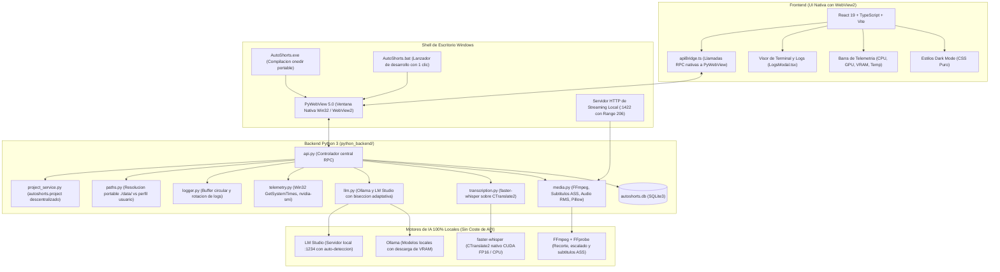

<div align="center">
  
  <h1>AutoShorts</h1>
  <p><strong>Suite de Escritorio 100% Local para Extracción y Edición de Clips Verticales Virales</strong></p>

  [](https://github.com/jeffd2599/autoshorts/releases)
  [-blue.svg)](https://github.com/jeffd2599/autoshorts/releases)
  [](https://www.python.org/)
  [](https://react.dev/)
  [](https://www.typescriptlang.org/)
  [](https://vitejs.dev/)
  [](https://pywebview.flowrl.com/)
  [](https://ffmpeg.org/)
  [](https://github.com/SYSTRAN/faster-whisper)
  [](https://pnpm.io/)
  [](https://opensource.org/licenses/MIT)
</div>

---

**AutoShorts** es una suite de escritorio a medida y de código abierto especializada en la **extracción, detección inteligente y edición de clips verticales virales (9:16 Shorts, TikToks y Reels)** a partir de grabaciones extensas de directos (Twitch, Kick o YouTube) y podcasts de 1 a 4+ horas.

Construida bajo una arquitectura **100% Local-First**, AutoShorts procesa todo el contenido utilizando la potencia de tu propio hardware: transcripción acelerada por GPU mediante **faster-whisper (CTranslate2)** e inferencia de lenguaje local con **Ollama** y **LM Studio**. No requiere suscripciones mensuales ni pagos por minuto en APIs externas.

> [!TIP]
> **🚀 Versión Portable Oficial (Zero-Install):** Para la gran mayoría de usuarios y creadores de contenido, **no es necesario instalar Python, Node.js ni compilar código**. Descarga el paquete [AutoShorts-v2.5.0-windows-x64-portable.zip](https://github.com/jeffd2599/autoshorts/releases) (~178 MB), descomprímelo en cualquier disco o pendrive y ejecuta directamente `AutoShorts.exe`.

> [!NOTE]
> **Filosofía 100% Local (Cero Coste Operativo):** Toda la transcripción, análisis de audio RMS, detección de ganchos virales y renderizado de subtítulos ocurre en tu máquina. Tus grabaciones nunca salen de tu red local y no gastas dinero en tokens ni límites de peticiones cloud.

---

## Indice

- [Arquitectura del Sistema](#arquitectura-del-sistema)
- [Funcionalidades Principales](#funcionalidades-principales)
  - [1. Deteccion Inteligente de Momentos y Chunks Adaptativos](#1-deteccion-inteligente-de-momentos-y-chunks-adaptativos)
  - [2. Arquitectura de Proyectos Autonomos (autoshorts.project)](#2-arquitectura-de-proyectos-autonomos-autoshortsproject)
  - [3. Visor de Terminal y Logs en Vivo](#3-visor-de-terminal-y-logs-en-vivo)
  - [4. Estudio de Subtitulos Dinamicos y Presets](#4-estudio-de-subtitulos-dinamicos-y-presets)
  - [5. IA Local y Gestion Inteligente de Hardware](#5-ia-local-y-gestion-inteligente-de-hardware)
  - [6. Modulo de Social Copywriting Conciso](#6-modulo-de-social-copywriting-conciso)
  - [7. Telemetria de Hardware en Tiempo Real](#7-telemetria-de-hardware-en-tiempo-real)
- [Descarga y Ejecucion Portable](#descarga-y-ejecucion-portable)
- [Requisitos Previos (Para Desarrolladores)](#requisitos-previos-para-desarrolladores)
- [Instalacion para Desarrolladores](#instalacion-para-desarrolladores)
- [Modos de Ejecucion](#modos-de-ejecucion)
  - [Modo 1: Binario Portable (AutoShorts.exe)](#modo-1-binario-portable-autoshortsexe)
  - [Modo 2: Lanzador Rapido (AutoShorts.bat)](#modo-2-lanzador-rapido-autoshortsbat)
  - [Modo 3: Modo Desarrollo (Hot Reload)](#modo-3-modo-desarrollo-hot-reload)
- [Configuracion y Almacenamiento Dual](#configuracion-y-almacenamiento-dual)
- [Estructura del Repositorio](#estructura-del-repositorio)
- [Resolucion de Problemas Frecuentes](#resolucion-de-problemas-frecuentes)
- [Creditos y Licencia](#creditos-y-licencia)

---

## Arquitectura del Sistema



---

## Funcionalidades Principales

### 1. Deteccion Inteligente de Momentos y Chunks Adaptativos

El motor de escaneo combina analisis de volumen acustico con comprension semantica del dialogo para aislar los fragmentos con mayor potencial de viralidad:

- **Prompt Fusionado de Alta Retencion:** Instruye al LLM local bajo directrices editoriales estrictas:
  - *Ganchos de Alto Impacto:* Frases polemicas, preguntas intrigantes, remates o revelaciones en los primeros 3 segundos.
  - *Picos Emocionales y Gameplay:* Clutches, jugadas destacadas, risas contagiosas, gritos, enfados, sustos o celebraciones.
  - *Contenido Narrativo y Humor:* Fails comicos, anecdotas rapidas, debates intensos o explicaciones condensadas.
- **Reglas Estrictas de Segmentacion:**
  - *Auto-conclusion:* Cada clip posee inicio claro, desarrollo y remate o conclusion logica, sin depender de contexto externo.
  - *Cortes limpios:* Jamas corta una palabra o frase a la mitad, usando silencios y pausas naturales como puntos de transicion.
  - *Exclusiones:* Descarta introducciones lentas, transiciones vacias y segmentos promocionales.
- **Segmentacion Dinamica Adaptativa por Biseccion:** AutoShorts detecta la ventana de contexto de tu motor local (4k, 8k o 16k tokens) y dimensiona dinamicamente los bloques temporales. Si un segmento sobrepasa el contexto (`exceed_context_size_error`), el algoritmo aplica biseccion recursiva subdividiendo el bloque a la mitad de forma automatica. Esto permite operar fluidamente con ventanas ajustadas (4k/8k) para ahorrar VRAM sin provocar errores HTTP 400.
- **Circuit Breaker Preventivo:** Si el modelo es descargado o la conexion con el servidor local se interrumpe, el pipeline se detiene de inmediato notificando al usuario en vez de iterar fallidamente sobre los bloques restantes.
- **Analisis acustico RMS:** Algoritmo en Python puro (`wave`, `struct`, `math`) con soporte de cancelacion inmediata. Si el creador esta concentrado en una jugada tensa sin hablar, el detector identifica picos sonoros e inyecta la etiqueta `[CLUTCH / ACCION ACUSTICA]` en la transcripcion.
- **Duraciones objetivo configurables:** Rango de tiempos ajustables de 30s, 1m, 2m, 3m o 5m.

---

### 2. Arquitectura de Proyectos Autonomos (`autoshorts.project`)

Inspirado en editores de video profesionales (como Premiere Pro o CapCut), AutoShorts guarda cada proyecto de forma descentralizada:

- **Archivo de Proyecto Autónomo:** En la raíz de cada carpeta de grabación se genera automáticamente un archivo `autoshorts.project`.
- **Portabilidad de Datos:** Contiene la transcripción completa palabra por palabra, los candidatos detectados y los clips exportados. Si mueves la carpeta a otra PC o a un disco externo, AutoShorts lo reconoce al instante y **omite volver a transcribir con Whisper**.
- **Auto-Migración Transparente:** Los proyectos preexistentes en la base de datos se exportan automáticamente a `autoshorts.project` al cargarlos.
- **Re-vinculación Inteligente:** Si cambias la unidad de disco (por ejemplo de `D:\` a `E:\`), el sistema detecta si el video sigue en la misma carpeta relativa y lo re-vincula de inmediato.

---

### 3. Visor de Terminal y Logs en Vivo

AutoShorts incorpora un terminal de diagnóstico integrado para supervisar todo lo que ocurre bajo el capó sin necesidad de consolas externas:

- **Acceso Rápido:** Accesible desde el botón de consola en el menú lateral (`Sidebar`) y en la barra de estado inferior (`StatusBar`).
- **Buffer Circular en Memoria:** Mantiene las últimas 1,000 líneas con formateo visual según severidad (`INFO`, `WARNING`, `ERROR`, `SUCCESS`).
- **Herramientas de Utilidad:** Auto-scroll automático, botón de pausar seguimiento, limpieza de pantalla y copiado rápido al portapapeles.
- **Persistencia Física con Rotación:** Escritura automática en `autoshorts.log` con rotación a 5 MB para evitar consumo de disco.

---

### 4. Estudio de Subtitulos Dinamicos y Presets

El motor multimedia genera subtitulos en formato SubStation Alpha (`.ass`) con sincronizacion palabra por palabra, renderizados mediante el filtro `ass` de FFmpeg con aceleracion por hardware:

| Preset | Tipografia | Paleta y Resalte | Descripcion |
| :--- | :--- | :--- | :--- |
| **`tiktok-karaoke`** | Arial Black | Blanco con resalte amarillo neon | Estilo clasico de alta retencion con animacion de escala (jump/pop) en la palabra activa. |
| **`loud-viral`** | Impact (Ultra-bold) | Trazo 3D masivo, amarillo lima y fuego naranja | Diseno de alto ritmo con fuerte enfasis en palabras clave. |
| **`arcade-retro`** | Trebuchet MS | Borde rosa magenta con resalte cian activo | Estetica de videojuego arcade y eSports retro. |
| **`cyber-terminal`** | Consolas (Monospace) | Verde fosforo con resalte cian electrico | Aspecto de terminal informatica y estetica tecnica. |
| **`clean-editorial`** | Segoe UI | Blanco puro, borde fino y sombra suave multinivel | Diseno sobrio adecuado para podcasts, entrevistas y debates. |
| **`modern-box`** | Arial | Texto sobre caja opaca delimitada | Maxima legibilidad en fondos con alto movimiento o colores saturados. |

#### Opciones de Personalizacion
- **Posicion en pantalla:** Superior, Centro o Inferior (para evitar tapar interfaces del juego, webcams o botones de interaccion de TikTok/Reels).
- **Densidad de texto:** Visualizacion en 1 o 2 lineas continuas.
- **Stickers Tipográficos con Supersampling 2X:** Renderizado nítido mediante Pillow (`PIL`) con soporte de emojis, cajas translúcidas y bordes de alta definición.

---

### 5. IA Local y Gestion Inteligente de Hardware

- **Inicio Directo sin Bloqueos:** Inicia directamente en el Dashboard. Detecta automaticamente si LM Studio u Ollama estan activos sin imponer descargas forzosas.
- **Deteccion Dinamica de VRAM y GPU:** Clasifica dinamicamente los modelos Whisper y LLM en tres niveles (`Optimo`, `Moderado` y `Pesado`) segun la VRAM disponible (4GB, 6GB, 8GB, 12GB, 16GB o CPU).
- **Cancelacion Inmediata con Liberacion Total:** Al cancelar la transcripcion o la busqueda de momentos, AutoShorts desreferencia de inmediato los modelos de memoria y vacia la GPU al instante.
- **faster-whisper sobre CTranslate2 Nativo:** Inferencia ultrarrápida en GPU NVIDIA CUDA FP16 sin depender del runtime pesado de PyTorch.
- **Descarga inmediata de VRAM (`keep_alive: 0`):** Al finalizar la deteccion o generacion de copys, ordena al servidor local liberar de inmediato la memoria de la tarjeta grafica.

---

### 6. Modulo de Social Copywriting Conciso

- **Formato Ultra-Conciso (2 a 3 lineas):** Textos compactos con gancho intrigante, una oracion de contexto y llamada a la accion sin relleno.
- **Limite Estricto de 3 a 5 Hashtags:** Previene penalizaciones algoritmicas por saturacion de etiquetas.
- **Alineacion Exacta con la Transcripcion:** La funcion de "Rehacer Copy" toma unicamente las palabras habladas entre los timestamps reales del clip.

---

### 7. Telemetria de Hardware en Tiempo Real

Barra de estado inferior persistente con actualizacion periodica continua:
- **CPU %:** Medicion nativa con `GetSystemTimes` de la API Win32 (sin consumo de CPU).
- **GPU y VRAM:** Lectura directa de porcentaje de carga y memoria asignada mediante `nvidia-smi`.
- **Temperatura de la GPU (°C):** Control termico en tiempo real durante renderizados intensivos con FFmpeg.

---

## Descarga y Ejecucion Portable

Para la inmensa mayoría de usuarios, no se requiere instalación manual:

1. Ve a la sección de [Releases oficiales en GitHub](https://github.com/jeffd2599/autoshorts/releases).
2. Descarga el archivo: `AutoShorts-v2.5.0-windows-x64-portable.zip` (~178 MB).
3. Descomprime la carpeta en la ubicación que prefieras (disco local o pendrive).
4. Haz doble clic en `AutoShorts.exe`.

Tus configuraciones y datos se almacenarán en `./data/` de forma autónoma.

---

## Requisitos Previos (Para Desarrolladores)

Si deseas clonar el repositorio y ejecutar el código fuente o desarrollar extensiones:

| Componente | Requisito Minimo | Recomendado | Notas |
| :--- | :--- | :--- | :--- |
| **Sistema Operativo** | Windows 10 (64-bit) | Windows 11 (64-bit) | Compatible con Linux y macOS en modo desarrollo. |
| **Python** | 3.10 | **3.11.x** | Version recomendada para compatibilidad nativa con CTranslate2 y PyWebView. |
| **Node.js** | 18.x (LTS) | 20.x o superior | Requerido para compilar la interfaz de usuario. |
| **Gestor de Paquetes** | **pnpm 9+** | **pnpm 9+** | Gestor obligatorio para dependencias del frontend. |
| **FFmpeg y FFprobe** | Version 5.x | **Version 6.x o 7.x en el PATH** | Indispensable para cortes, subtitulos ASS y analisis RMS de audio. |
| **GPU NVIDIA (Opcional)** | CPU Intel / AMD | **NVIDIA GeForce RTX (CUDA)** | Aceleración nativa de transcripción con faster-whisper. |

### Instalacion de FFmpeg
- **Windows (PowerShell):** `winget install Gyan.FFmpeg`
- **macOS:** `brew install ffmpeg`
- **Linux (Ubuntu / Debian):** `sudo apt update && sudo apt install -y ffmpeg`

---

## Instalacion para Desarrolladores

### 1. Clonar el Repositorio
```bash
git clone https://github.com/jeffd2599/autoshorts.git
cd autoshorts
```

### 2. Configurar el Entorno Virtual de Python
```bash
python -m venv venv

# En Windows (PowerShell):
.\venv\Scripts\Activate.ps1

# En Linux o macOS:
source venv/bin/activate
```

### 3. Instalar Dependencias del Backend
```bash
pip install -r requirements.txt
```
> [!NOTE]
> `faster-whisper` utiliza CTranslate2 para ejecutar CUDA FP16 directamente. No es necesario instalar paquetes masivos de PyTorch.

### 4. Instalar y Compilar el Frontend con pnpm
```bash
pnpm install
pnpm run build
```

---

## Modos de Ejecucion

### Modo 1: Binario Portable (AutoShorts.exe)
Ejecución zero-install sin consolas ni dependencias externas.

### Modo 2: Lanzador Rapido (AutoShorts.bat)
Doble clic en `AutoShorts.bat`. Detecta automáticamente el entorno virtual (`venv`, `.venv`, `env`) o el Python del sistema e inicia la aplicación con diagnóstico en caso de error.

### Modo 3: Modo Desarrollo (Hot Reload)
Para editar la interfaz en tiempo real mientras el backend permanece activo:
1. **Terminal 1 (Vite Dev Server):**
   ```bash
   pnpm run dev
   ```
2. **Terminal 2 (Desktop Launcher):**
   ```bash
   AutoShorts.bat
   ```
El lanzador detectará el servidor en `http://127.0.0.1:1420` y conectará la ventana nativa con recarga en caliente automática.

---

## Configuracion y Almacenamiento Dual

AutoShorts gestiona el almacenamiento de datos de forma inteligente a través de `python_backend/paths.py`:

- **Modo Portable:** Si existe el archivo marcador `portable.mode` (junto al ejecutable), la base de datos `autoshorts.db`, el registro de logs `autoshorts.log` y la configuración `config.json` se guardan localmente en `./data/`.
- **Modo Instalado / Desarrollo:** Si no está en modo portable, se almacena en el perfil del usuario:
  ```text
  %USERPROFILE%\.autoshorts\config.json
  %USERPROFILE%\.autoshorts\autoshorts.db
  ```

---

## Estructura del Repositorio

```text
autoshorts/
├── python_backend/               # Backend en Python 3
│   ├── api.py                    # Controlador RPC principal expuesto a PyWebView
│   ├── db.py                     # Capa de datos en SQLite3 embebido
│   ├── llm.py                    # Orquestador de LLMs locales (Ollama y LM Studio)
│   ├── llm_prompts.py            # Plantillas de prompts especializadas para clips
│   ├── logger.py                 # Buffer circular de logs y rotacion en autoshorts.log
│   ├── media.py                  # Integracion con FFmpeg, subtitulos ASS, audio RMS y Pillow
│   ├── paths.py                  # Resolucion de rutas portables (./data/ vs %USERPROFILE%)
│   ├── stream_server.py          # Servidor HTTP local con soporte Range 206 para videos
│   ├── telemetry.py              # Telemetria de CPU (Win32), GPU, VRAM y temperatura
│   ├── transcription.py          # Pipeline optimizado con faster-whisper (CTranslate2)
│   ├── version.py                # Fuente de verdad de versionado semantico (v2.5.0)
│   └── services/                 # Servicios modulares
│       └── project_service.py    # Proyectos autonomos (autoshorts.project) y auto-migracion
├── src/                          # Frontend en React 19 + TypeScript
│   ├── components/               # Componentes modulares de interfaz
│   │   ├── common/               # Componentes reutilizables (StatusBar, ModelBadge)
│   │   ├── modals/               # Modales de trabajo (StyleModal, CandidatePreview, LogsModal)
│   │   └── panels/               # Vistas principales (HomeDashboard, CandidatePanel, Sidebar)
│   ├── hooks/                    # Hooks de estado y pipelines (useMediaPipeline, useProjectActions)
│   ├── styles/                   # Sistema de diseno dark mode en CSS puro
│   ├── types.ts                  # Definiciones de tipos TypeScript compartidos
│   ├── apiBridge.ts              # Adaptador RPC nativo para PyWebView
│   └── App.tsx                   # Componente raiz de la aplicacion
├── AutoShorts.bat                # Lanzador con deteccion de venv y diagnostico
├── AutoShorts.spec               # Especificacion PyInstaller onedir con assets e iconos
├── build_portable.py             # Script de construccion de paquete portable .zip con SHA-256
├── run.py                        # Punto de entrada principal con freeze_support
├── requirements.txt              # Dependencias de Python (faster-whisper, pywebview, pillow)
├── package.json                  # Scripts y dependencias del frontend (pnpm, v2.5.0)
├── pnpm-lock.yaml                # Lockfile oficial de pnpm
├── vite.config.ts                # Configuracion del empaquetador Vite
├── DECISIONS.md                  # Registro de decisiones de arquitectura (D-001 a D-015)
└── README.md                     # Documentacion tecnica del proyecto
```

---

## Resolucion de Problemas Frecuentes

### 1. `ffmpeg` o `ffprobe` no se reconocen como un comando
- Verifica que instalaste FFmpeg y que su subcarpeta `bin` esta incluida en la variable de entorno `PATH` de Windows.
- Comprueba la salida en terminal con `ffmpeg -version`.

### 2. faster-whisper no utiliza la tarjeta grafica NVIDIA
- CTranslate2 utiliza la GPU NVIDIA mediante sus librerías nativas.
- Puedes comprobar si tu entorno detecta la GPU ejecutando en consola:
  ```bash
  python -c "import ctranslate2; print('Dispositivos CUDA detectados:', ctranslate2.get_cuda_device_count())"
  ```
- Si devuelve `1` o más, la aceleración GPU está plenamente operativa.

### 3. No se detecta Ollama o LM Studio
- **Ollama:** Comprueba que el servicio esta activo visitando en tu navegador `http://127.0.0.1:11434`.
- **LM Studio:** En la pestaña "Local Server", presiona el botón "Start Server" y verifica que el puerto sea el `1234`.

### 4. El archivo fuente del video se movio o renombro
- Si cambiaste de ubicación una grabación original, AutoShorts marcará el proyecto con una advertencia en el dashboard.
- Haz clic en el botón de re-vincular para seleccionar la nueva ruta del archivo sin perder tus transcripciones ni tus momentos detectados.

---

## Creditos y Licencia

Este proyecto es una evolución y desarrollo derivado del trabajo conceptual de [JayWebtech/autoshorts](https://github.com/JayWebtech/autoshorts).

### Fundamentos de la Migracion a Python
La versión conceptual previa utilizaba una arquitectura basada en Rust (Tauri). Para este desarrollo, el backend fue reescrito íntegramente en **Python 3.11 sobre PyWebView**, aportando ventajas directas:
1. **Instalacion directa sin herramientas de compilacion complejas:** Elimina la necesidad de instalar el toolchain de Rust (`cargo`, `rustc`) ni Microsoft Visual C++ Build Tools.
2. **Inferencia local con aceleración GPU:** Integración nativa con `faster-whisper` sobre `CTranslate2` y comunicación directa con Ollama y LM Studio.
3. **Mantenibilidad y Portabilidad:** Todo el pipeline multimedia y los algoritmos acústicos RMS operan en código limpio y pueden distribuirse de forma 100% portable.

Este software se distribuye bajo los términos de la **Licencia MIT**. Consulta el archivo [LICENSE](LICENSE) para más información.
