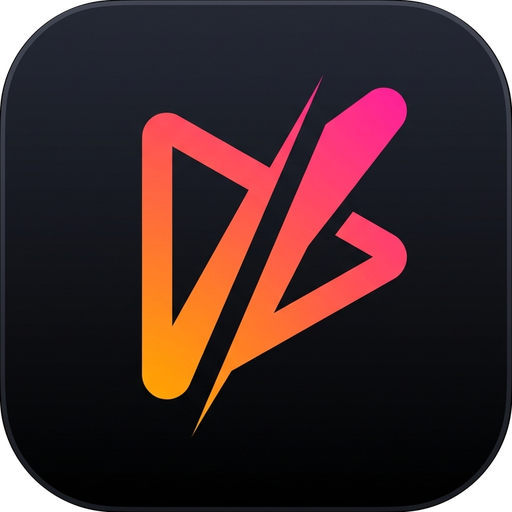
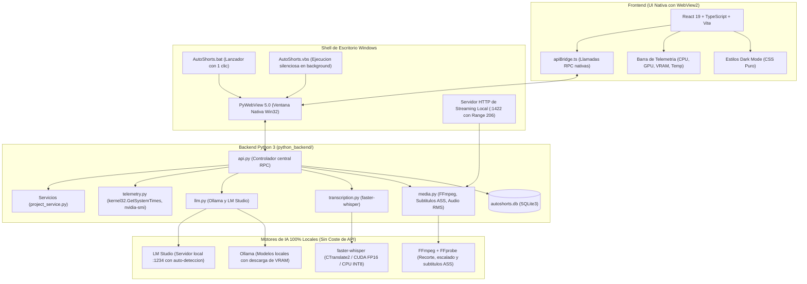

<div align="center">
  
  <h1>AutoShorts</h1>
  <p><strong>Suite de Escritorio 100% Local para Extracción y Edición de Clips Verticales Virales</strong></p>

  [](https://www.python.org/)
  [](https://react.dev/)
  [](https://www.typescriptlang.org/)
  [](https://vitejs.dev/)
  [](https://pywebview.flowrl.com/)
  [](https://ffmpeg.org/)
  [](https://github.com/SYSTRAN/faster-whisper)
  [](https://pnpm.io/)
  [](https://opensource.org/licenses/MIT)
</div>

---

**AutoShorts** es una suite de escritorio a medida y de código abierto especializada en la **extracción, detección inteligente y edición de clips verticales virales (9:16 Shorts, TikToks y Reels)** a partir de grabaciones extensas de directos (Twitch, Kick o YouTube) y podcasts de 1 a 4+ horas.

Construida bajo una arquitectura **100% Local-First**, AutoShorts procesa todo el contenido utilizando la potencia de tu propio hardware: transcripción acelerada por GPU mediante **faster-whisper** e inferencia de lenguaje local con **Ollama** y **LM Studio**. No requiere suscripciones mensuales ni pagos por minuto en APIs externas.

> [!TIP]
> **Filosofía 100% Local (Cero Coste Operativo):** Toda la transcripción, análisis de audio RMS, detección de ganchos virales y renderizado de subtítulos ocurre en tu máquina. Tus grabaciones nunca salen de tu red local y no gastas dinero en tokens ni límites de peticiones cloud.

---

## Indice

- [Arquitectura del Sistema](#arquitectura-del-sistema)
- [Funcionalidades Principales](#funcionalidades-principales)
  - [1. Deteccion Inteligente de Momentos](#1-deteccion-inteligente-de-momentos)
  - [2. Estudio de Subtitulos Dinamicos y Presets](#2-estudio-de-subtitulos-dinamicos-y-presets)
  - [3. IA Local y Gestion Inteligente de VRAM](#3-ia-local-y-gestion-inteligente-de-vram)
  - [4. Modulo Quick Copy para Transcripciones y Subtitulos](#4-modulo-quick-copy-para-transcripciones-y-subtitulos)
  - [5. Telemetria de Hardware en Tiempo Real](#5-telemetria-de-hardware-en-tiempo-real)
- [Requisitos Previos y Compatibilidad](#requisitos-previos-y-compatibilidad)
- [Instalacion Paso a Paso](#instalacion-paso-a-paso)
- [Modos de Ejecucion](#modos-de-ejecucion)
  - [Lanzador Rapido (AutoShorts.bat)](#lanzador-rapido-autoshortsbat)
  - [Lanzador Silencioso (AutoShorts.vbs)](#lanzador-silencioso-autoshortsvbs)
  - [Modo Desarrollo (Hot Reload)](#modo-desarrollo-hot-reload)
- [Configuracion y Variables de Entorno](#configuracion-y-variables-de-entorno)
- [Estructura del Repositorio](#estructura-del-repositorio)
- [Resolucion de Problemas Frecuentes](#resolucion-de-problemas-frecuentes)
- [Roadmap y Futura Release Portable](#roadmap-y-futura-release-portable)
- [Creditos y Licencia](#creditos-y-licencia)

---

## Arquitectura del Sistema



---

## Funcionalidades Principales

### 1. Deteccion Inteligente de Momentos

El motor de escaneo combina analisis de volumen acustico con comprension semantica del dialogo para aislar los fragmentos con mayor potencial de viralidad en TikTok, YouTube Shorts e Instagram Reels:

- **Prompt Fusionado de Alta Retencion:** El sistema opera con un prompt base altamente especializado que instruye al modelo bajo criterios de edicion profesional:
  - *Ganchos de Alto Impacto:* Frases polemicas, preguntas intrigantes, remates o revelaciones en los primeros 3 segundos.
  - *Picos Emocionales y Gameplay:* Clutches, jugadas destacadas, risas contagiosas, gritos, enfados (rage quits), sustos o celebraciones.
  - *Contenido Narrativo y Humor:* Fails comicos, anecdotas rapidas, debates intensos o explicaciones de alto valor simplificadas.
- **Reglas Estrictas de Segmentacion:**
  - *Auto-conclusion:* Cada clip debe poseer inicio claro, desarrollo y remate o conclusion logica, sin depender de contexto externo.
  - *Cortes limpios:* Jamas corta una palabra o frase a la mitad, usando silencios y pausas naturales como puntos de transicion.
  - *Exclusiones:* Descarta introducciones lentas, transiciones vacias y segmentos promocionales.
- **Capa Tecnica Invisible:** La interfaz de configuracion muestra unicamente las directrices editoriales limpias. El contrato JSON estricto (`candidates`/`clips`), los timestamps y los requisitos de duracion se gestionan internamente en el backend.
- **Segmentacion Dinamica Adaptativa (Divide y Venceras):** AutoShorts detecta la ventana de contexto de tu motor local (4k, 8k o 16k tokens) y dimensiona dinamicamente los bloques temporales. Si un segmento tiene demasiada densidad de dialogo y sobrepasa el contexto (`exceed_context_size_error`), el algoritmo aplica biseccion recursiva subdividiendo el bloque a la mitad de forma automatica. Esto permite mantener tu LLM en 8k de contexto para ahorrar VRAM sin perder ningun momento viral ni provocar errores HTTP 400.
- **Circuit Breaker Preventivo:** Si el modelo es descargado en LM Studio o la conexion con el servidor local se interrumpe, el pipeline se detiene de inmediato notificando al usuario en vez de iterar fallidamente sobre los bloques restantes.
- **Analisis acustico RMS en milisegundos:** Algoritmo en Python puro (`wave`, `struct`, `math`) con soporte de cancelacion inmediata. Si el creador esta concentrado en una jugada tensa sin hablar, el detector identifica picos sonoros e inyecta la etiqueta `[CLUTCH / ACCION ACUSTICA]` en la transcripcion para que el LLM no descarte el fragmento por falta de dialogo.
- **Duraciones objetivo configurables:** Generacion de clips con rangos de tiempo ajustables de 30s, 1m, 2m, 3m o 5m.

---

### 2. Estudio de Subtitulos Dinamicos y Presets

El motor multimedia genera subtitulos en formato SubStation Alpha (`.ass`) con sincronizacion palabra por palabra, renderizados mediante el filtro `ass` de FFmpeg con aceleracion por hardware:

| Preset | Tipografia | Paleta y Resalte | Descripcion |
| :--- | :--- | :--- | :--- |
| **`tiktok-karaoke`** | Arial Black | Blanco con resalte amarillo neon | Estilo clasico de alta retencion con animacion de escala (jump/pop) en la palabra activa. |
| **`loud-viral`** | Impact (Ultra-bold) | Trazo 3D masivo, amarillo lima y fuego naranja | Diseno de alto ritmo con fuerte enfasis en palabras clave. |
| **`arcade-retro`** | Trebuchet MS | Borde rosa magenta con resalte cian activo | Estetica de videojuego arcade y eSports retro. |
| **`cyber-terminal`** | Consolas (Monospace) | Verde fosforo con resalte cian electrico | Aspecto de terminal informatica y estetica tecnica. |
| **`clean-editorial`** | Segoe UI | Blanco puro, borde fino y sombra suave multinivel | Diseno sobrio adecuado para podcasts, entrevistas y debates. |
| **`modern-box`** | Arial | Texto sobre caja opaca delimitada | Maxima legibilidad en fondos con alto movimiento o colores saturados. |

#### Opciones de Personalizacion
- **Posicion en pantalla:** Superior, Centro o Inferior (para evitar tapar interfaces del juego, webcams o botones de interaccion de TikTok/Reels).
- **Densidad de texto:** Visualizacion en 1 o 2 lineas continuas.
- **Insignias CTA animadas:** Superposicion de distintivos de llamada a la accion ("Suscribete", "Sigueme para parte 2") con animaciones de rebote (bounce-land), deslizamiento lateral o aparicion progresiva.

---

### 3. IA Local y Gestion Inteligente de Hardware

AutoShorts funciona integramente con modelos instalados en tu propio equipo, sin cuotas ni dependencias cloud:

- **Inicio Directo sin Bloqueos:** El software inicia directamente en el Dashboard de proyectos. Detecta automaticamente si LM Studio u Ollama estan activos sin imponer descargas forzosas ni modales de bienvenida bloqueantes.
- **Deteccion Dinamica de VRAM y GPU:** Evalua la memoria grafica real disponible en tu sistema (4GB, 6GB, 8GB, 12GB, 16GB o CPU) para clasificar dinamicamente los modelos en tres niveles (`Optimo`, `Moderado` y `Pesado`), adaptandose con precision al hardware de cualquier usuario.
- **Cancelacion Inmediata con Liberacion Total:** Al cancelar la transcripcion o la busqueda de momentos, AutoShorts elimina de inmediato generadores y modelos de memoria, ejecutando recoleccion de basura (`gc.collect()`) y vaciado de cache CUDA (`torch.cuda.empty_cache()`), garantizando que la GPU quede completamente libre al instante.
- **faster-whisper (CTranslate2):** Transcripcion ultra-rapida con soporte de precision mixta (CUDA FP16 / float32 / int8). Los modelos se agrupan inteligentemente priorizando los ya descargados en disco.
- **Ollama y LM Studio:** Compatibilidad completa con ambos motores locales (`qwen2.5`, `llama3.2`, `mistral`, `gemma2`, `gemma4`, etc.).
- **Descarga inmediata de VRAM (`keep_alive: 0`):** Al finalizar la deteccion o generacion de copys, AutoShorts ordena al servidor local liberar de inmediato la memoria de la tarjeta grafica, permitiendo jugar o editar sin caidas de rendimiento.


---

### 4. Modulo de Social Copywriting (TikTok, Shorts y Reels)

Generador de copys optimizado bajo estandares de retencion y comunicacion directa (sin relleno de IA):

- **Formato Ultra-Conciso (2 a 3 lineas):** En TikTok e Instagram Reels los textos extensos tapan los subtitulos del video y activan el boton "...mas". AutoShorts produce textos compactos con gancho intrigante, una oracion de contexto y llamada a la accion conversacional.
- **Limite Estricto de 3 a 5 Hashtags:** Previene penalizaciones algoritmicas por hashtag spam, forzando exactamente entre 3 y 5 etiquetas altamente relevantes.
- **Alineacion Exacta con la Transcripcion:** La funcion de "Rehacer Copy" toma unicamente las palabras habladas entre los timestamps reales de inicio y fin (`startSec` y `endSec`) del clip seleccionado, preservando intacto el titulo original.

---

### 5. Telemetria de Hardware en Tiempo Real

Barra de estado inferior persistente con actualizacion periodica continua:
- **CPU %:** Medicion no bloqueante con `GetSystemTimes` de la API de Win32.
- **GPU y VRAM:** Lectura directa de porcentaje de carga y memoria asignada mediante `nvidia-smi` (con respaldo en PyTorch CUDA).
- **Temperatura de la GPU (°C):** Control termico en tiempo real durante renderizados intensivos con FFmpeg.

---

## Requisitos Previos y Compatibilidad

| Componente | Requisito Minimo | Recomendado | Notas |
| :--- | :--- | :--- | :--- |
| **Sistema Operativo** | Windows 10 (64-bit) | Windows 11 (64-bit) | Compatible tambien con Linux y macOS en modo desarrollo. |
| **Python** | 3.10 | **3.11.x** | Version recomendada para compatibilidad con PyTorch CUDA y PyWebView. |
| **Node.js** | 18.x (LTS) | 20.x o superior | Requerido para compilar la interfaz de usuario. |
| **Gestor de Paquetes** | **pnpm 9+** | **pnpm 9+** | Gestor obligatorio para instalar dependencias y compilar el frontend. |
| **FFmpeg y FFprobe** | Version 5.x | **Version 6.x o 7.x en el PATH** | Indispensable para cortes, subtitulos ASS y analisis RMS de audio. |
| **GPU NVIDIA (Opcional)** | CPU Intel / AMD | **NVIDIA RTX con soporte CUDA** | Permite transcribir horas de stream en pocos minutos. |

### Instalacion de FFmpeg

Asegurate de que `ffmpeg` y `ffprobe` respondan desde la terminal:

- **Windows (PowerShell):**
  ```powershell
  winget install Gyan.FFmpeg
  ```
- **macOS:**
  ```bash
  brew install ffmpeg
  ```
- **Linux (Ubuntu / Debian):**
  ```bash
  sudo apt update && sudo apt install -y ffmpeg
  ```

---

## Instalacion Paso a Paso

### 1. Clonar el Repositorio
```bash
git clone https://github.com/jeffd2599/autoshorts.git
cd autoshorts
```

### 2. Configurar el Entorno Virtual de Python
```bash
# Crear entorno virtual
python -m venv venv

# Activar en Windows (PowerShell):
.\venv\Scripts\Activate.ps1

# Activar en Linux o macOS:
source venv/bin/activate
```

### 3. Instalar PyTorch

Para acelerar la transcripcion por hardware con CUDA:

```bash
# Con soporte NVIDIA CUDA 12.1 (Recomendado):
pip install torch torchvision torchaudio --index-url https://download.pytorch.org/whl/cu121

# O version para CPU / sin tarjeta grafica NVIDIA:
pip install torch torchvision torchaudio
```

### 4. Instalar Dependencias del Backend
```bash
pip install -r requirements.txt
```

### 5. Instalar y Compilar el Frontend con pnpm
```bash
pnpm install
pnpm run build
```

---

## Modos de Ejecucion

### Lanzador Rapido (AutoShorts.bat)

La forma mas comoda y directa de iniciar la aplicacion. Simplemente haz doble clic en el archivo:

```text
AutoShorts.bat
```

Este script por lotes:
1. Detecta automaticamente si existe un entorno virtual (`venv`, `.venv`, `env`) o utiliza el Python del sistema.
2. Inicia el servidor de streaming local y abre la ventana nativa de escritorio.
3. Si ocurre algun error imprevisto, mantiene la consola abierta para diagnostico en lugar de cerrarse abruptamente.

---

### Lanzador Silencioso (AutoShorts.vbs)

Si prefieres abrir la aplicacion sin ninguna ventana de consola negra visible en Windows, haz doble clic en:

```text
AutoShorts.vbs
```

---

### Modo Desarrollo (Hot Reload)

Para editar la interfaz en tiempo real mientras el backend permanece activo:

1. **Terminal 1 (Vite Dev Server):**
   ```bash
   pnpm run dev
   ```
2. **Terminal 2 (Desktop Launcher):**
   ```bash
   AutoShorts.bat
   ```

El lanzador detectara el servidor en `http://127.0.0.1:1420` y conectara la ventana nativa con recarga en caliente automatica.

---

## Configuracion y Variables de Entorno

Puedes configurar opciones base mediante un archivo `.env` en la raiz del proyecto:

```env
# Proveedor local de LLM (ollama o lmstudio)
LLM_PROVIDER=ollama

# Servidor Local LM Studio (Opcional, por defecto http://127.0.0.1:1234/v1)
LMSTUDIO_BASE_URL=http://127.0.0.1:1234/v1
```

La configuracion persistente de la aplicacion (modelo Whisper seleccionado, estilo de subtitulos por defecto, carpetas de salida) se guarda en:
```text
%USERPROFILE%\.autoshorts\config.json
```

---

## Estructura del Repositorio

```text
autoshorts/
├── python_backend/               # Backend en Python 3
│   ├── api.py                    # Controlador RPC principal expuesto a PyWebView
│   ├── db.py                     # Capa de datos en SQLite3 embebido
│   ├── llm.py                    # Orquestador de LLMs locales (Ollama y LM Studio)
│   ├── llm_prompts.py            # Plantillas de prompts especializadas para clips
│   ├── logger.py                 # Buffer circular de logs y rotacion en autoshorts.log
│   ├── media.py                  # Integracion con FFmpeg, subtitulos ASS y audio RMS
│   ├── paths.py                  # Resolucion de rutas portables (RESOURCE_DIR vs USER_DATA_DIR)
│   ├── stream_server.py          # Servidor HTTP local con soporte Range para videos
│   ├── telemetry.py              # Telemetria de CPU, GPU, VRAM y temperatura
│   ├── transcription.py          # Pipeline optimizado con faster-whisper (CTranslate2)
│   ├── version.py                # Fuente de verdad de versionado semantico (v2.5.0)
│   └── services/                 # Servicios modulares
│       └── project_service.py    # Proyectos autonomos (autoshorts.project) y auto-migracion
├── src/                          # Frontend en React 19 + TypeScript
│   ├── components/               # Componentes modulares de interfaz
│   │   ├── common/               # Componentes reutilizables (StatusBar, ModelBadge)
│   │   ├── modals/               # Modales de trabajo (StyleModal, CandidatePreview, LogsModal)
│   │   └── panels/               # Vistas principales (HomeDashboard, CandidatePanel, Sidebar)
│   ├── hooks/                    # Hooks de estado y pipelines (useMediaPipeline, useProjectActions)
│   ├── styles/                   # Sistema de diseno dark mode en CSS puro
│   ├── types.ts                  # Definiciones de tipos TypeScript compartidos
│   ├── apiBridge.ts              # Adaptador RPC para comunicacion con Python
│   └── App.tsx                   # Componente raiz de la aplicacion
├── AutoShorts.bat                # Lanzador con deteccion de venv y diagnostico
├── AutoShorts.vbs                # Lanzador silencioso en segundo plano para Windows
├── AutoShorts.spec               # Especificacion PyInstaller onedir con assets e iconos
├── build_portable.py             # Script de construccion de paquete portable .zip con SHA-256
├── run.py                        # Punto de entrada principal con freeze_support
├── requirements.txt              # Dependencias de Python (faster-whisper, pywebview)
├── package.json                  # Scripts y dependencias del frontend (pnpm, v2.5.0)
├── vite.config.ts                # Configuracion del empaquetador Vite
├── DECISIONS.md                  # Registro de decisiones de diseno y arquitectura
└── README.md                     # Documentacion tecnica del proyecto
```

---

## Resolucion de Problemas Frecuentes

### 1. `ffmpeg` o `ffprobe` no se reconocen como un comando
- Verifica que instalaste FFmpeg y que su subcarpeta `bin` esta incluida en la variable de entorno `PATH` de Windows.
- Abre una ventana nueva de terminal y comprueba la salida con `ffmpeg -version`.

### 2. faster-whisper no utiliza la tarjeta grafica NVIDIA
- Comprueba que instalaste la version de PyTorch con soporte CUDA.
- Puedes verificarlo ejecutando en consola:
  ```bash
  python -c "import torch; print('CUDA disponible:', torch.cuda.is_available(), '| Dispositivo:', torch.cuda.get_device_name(0) if torch.cuda.is_available() else 'Ninguno')"
  ```
- Si devuelve `False`, reinstala PyTorch con el indice `cu121` indicado en el paso 3 de la guia de instalacion.

### 3. No se detecta Ollama o LM Studio
- **Ollama:** Comprueba que el servicio esta activo visitando en tu navegador `http://127.0.0.1:11434`.
- **LM Studio:** En la pestana "Local Server", presiona el boton "Start Server" y verifica que el puerto sea el `1234`.

### 4. El archivo fuente del video se movio o renombro
- Si cambiaste de ubicacion una grabacion original, AutoShorts marcara el archivo con una advertencia en la lista de proyectos.
- Haz clic en el boton de re-vincular (icono de carpeta de busqueda) para seleccionar la nueva ruta del archivo sin perder tus transcripciones ni tus momentos detectados.

---

## Roadmap y Futura Release Portable

Para simplificar al maximo la distribucion a otros creadores sin requerir instalacion manual de dependencias de desarrollo, se contempla en el roadmap:

- **Version Portable para GitHub Releases:** Empaquetado integral que incluye el runtime embebido de Python, los binarios de FFmpeg y el frontend compilado en un archivo comprimido autonomo (zero-install).
- **Actualizador integrado:** Descarga automatica de nuevas versiones y modelos ligeros directamente desde GitHub Releases.

---

## Creditos y Licencia

Este proyecto es una evolucion y desarrollo derivado del trabajo conceptual de [JayWebtech/autoshorts](https://github.com/JayWebtech/autoshorts).

### Fundamentos de la Migracion a Python
La version conceptual previa utilizaba una arquitectura basada en Rust (Tauri). Para este desarrollo, el backend fue reescrito integramente en **Python 3.11**, aportando ventajas directas:
1. **Instalacion directa sin herramientas de compilacion complejas:** Elimina la necesidad de instalar el toolchain de Rust (`cargo`, `rustc`) ni Microsoft Visual C++ Build Tools.
2. **Acceso nativo a Machine Learning:** Integracion inmediata con PyTorch, aceleracion CUDA, faster-whisper con CTranslate2 y comunicacion directa con Ollama y LM Studio.
3. **Facilidad de mantenimiento:** El procesamiento multimedia y los algoritmos acusticos RMS pueden auditarse y modificarse directamente en codigo Python legible.

Este software se distribuye bajo los terminos de la **Licencia MIT**. Consulta el archivo [LICENSE](LICENSE) para mas informacion.
